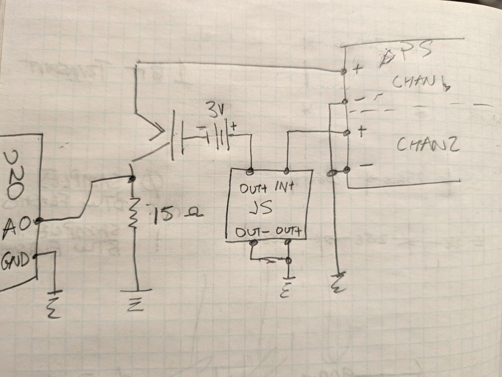

# scan-mosfet
Charatarize a MOSFET with an Ids versus Vg and Vd scan

> **Arduino-based scanner (v1):** there is now a standalone ~$30 rig — Arduino
> Uno + 2× MCP4725 — that runs a 3-phase device cycle (gate leakage,
> positive- and negative-Vgs Ids maps) with a guided bring-up wizard and
> self-tests. See [arduino-scanner/README.md](arduino-scanner/README.md) and
> [arduino-scanner/plan.md](arduino-scanner/plan.md). The Siglent+Joulescope
> bench below remains the reference instrument.
>
> **Web UI:** the rig also runs from the browser — live at
> [bigjosh.github.io/scan-mosfet](https://bigjosh.github.io/scan-mosfet/)
> (GitHub Pages from [/docs](docs/)) — live charts, scan history, the full
> bring-up wizard; try it with no hardware via `?demo`. Desktop Chrome
> connects via Web Serial.
>
> **Android app:** Chrome on Android currently blocks wired CDC serial
> (WebUSB class fence; wired Web Serial still behind a flag), so phones use
> the thin shell app in [/android](android/) — same web UI in a WebView plus
> a native USB bridge (genuine Unos *and* CH340/FTDI/CP210x clones). Install
> the APK from [Releases](https://github.com/bigjosh/scan-mosfet/releases);
> app features still update via git push.

## Which bench script?

| | `scan_mosfet.py` | `scan_mosfet_a.py` |
|---|---|---|
| Ids measured by | Joulescope JS110 in the drain line (nA resolution) | Arduino Uno reading a sense resistor in the source leg (µA resolution, see the table in its section) |
| Gate current | not measured | Joulescope JS110 in the gate line (nA resolution) |
| Vds readback | Joulescope voltage input (clips at 15.9 V) | source-node voltage from the Uno, so the device Vds and Vgs are known at every point |
| Negative Vgs | inline battery, `--vgs-offset` | same, battery between the Joulescope and the gate |
| Extra hardware | none | an Uno and one resistor |

Both scripts share the sweep, timing and output conventions, and the first three CSV columns are identical, so every plotting and analysis tool in this repo reads either file.

## Hardware

We have connected via USB a power supply and a Joulescope.

### Power supply (PS)

Siligent SPD3303C. We have installed NI VISA software and it is talking to the power supply.

### Joulescope (JS)

JS110. We have installed the Joulescope SDK and it is talking to the Joulescope.

## Connnections

This is the wiring for `scan_mosfet.py`. `scan_mosfet_a.py` is wired differently; see its section below.

We will use channel 1 of the PS to drive the Vds of the MOSFET, so both the ground and positive of the PS channel 1 are connected to INPUT terminals of the Joulsescope.

The OUT terminals of the Joulescope are connected to the POSITIVE to the Drain and NEGATIVE to the Source of the MOSFET.

We will use channel 2 of the PS to drive the Vgs of the MOSFET. The positive terminal of PS channel 2 is connected to the Gate of the MOSFET, and the negative terminal of PS channel 2 is connected to the Source of the MOSFET (also connected to the ground of the Joulescope OUT terminal).

## Installation

1. Install Python 3.8 or later
2. Install the required packages:
   ```bash
   pip install -r requirements.txt
   ```
3. Ensure NI-VISA is installed (for power supply communication)
4. Ensure Joulescope drivers are installed

## Usage

Run the program with default settings:
```bash
python scan_mosfet.py
```

Or customize the scan parameters (see Command line arguments section below).

## The program

This Python CLI program will sweep a configureable range of Vds and for each Vds it will sweep a   configureable range of Vgs and measure the Ids at each combination.

There is a configurable set-up time delay after each Vgs change to let the Ids settle before it is sampled. 

After the setup time delay the Ids is sampled a configurable number of times and the average is taken. The delay between samples is also configurable.

Default values are:

Vds = 0V to 15V in 0.1V steps
Vgs = 0V to Vds (whatever the current scanned value is) in 0.1V steps
set-up time delay = 1000ms (1 second)
number of samples = 10
consecutive sample delay = 10ms

Note that the program never changes either the ON/OFF state or current limit of either power supply channel- it only ever changes voltage. This is for safety. 

### Command line arguments

All scan parameters can be configured via command line arguments:

**Voltage Sweep:**
- `--vds-start FLOAT`: Starting Vds voltage in volts (default: 0.0)
- `--vds-stop FLOAT`: Stopping Vds voltage in volts (default: 15.0)
- `--vds-step FLOAT`: Vds voltage step in volts (default: 0.1)
- `--vgs-start FLOAT`: Starting Vgs voltage in volts (default: 0.0)
- `--vgs-stop FLOAT`: Stopping Vgs voltage in volts (default: same as `--vds-stop`)
- `--vgs-step FLOAT`: Vgs voltage step in volts (default: 0.1)
- `--vgs-offset FLOAT`: Voltage of an external bias in series with CH2, such as an inline battery, so that Vgs = CH2 + offset (default: 0.0). All `--vgs-*` values and the Vgs column in the CSV are the voltage at the gate; the script sets CH2 to Vgs - offset and refuses a sweep that would need CH2 below 0 V or above 32 V.

**Timing:**
- `--setup-delay FLOAT`: Setup delay after Vgs change in seconds (default: 1.0)
- `--num-samples INT`: Number of current samples to average (default: 10)
- `--sample-delay FLOAT`: Delay between consecutive samples in seconds (default: 0.01)

**Hardware:**
- `--current-limit FLOAT`: Current limit for power supply in amps (default: 3.0)
- `--visa-resource STRING`: VISA resource name for power supply (auto-detect if not specified)

**Output:**
- `--output STRING`: Output CSV filename (default: scan-mosfet-<timestamp>.csv)
- `--batch NAME`: put the CSV in `batches/NAME/` (created if needed) to group related scans; see Batches below
- `--quiet`: Disable progress output
- `--dry-run`: Run without Joulescope (generates mock current data for testing)

**Examples:**
```bash
# Full scan with default settings
python scan_mosfet.py

# Custom voltage range
python scan_mosfet.py --vds-stop 20 --vds-step 0.5 --output my_scan.csv

# Test run without Joulescope connected
python scan_mosfet.py --dry-run --vds-stop 1.0

# Gate biased by a -3 V battery in series with CH2: sweep the gate from -3 V to 20 V
python scan_mosfet.py --vgs-offset -3 --vgs-start -3 --vgs-stop 20 --vgs-step 1 --vds-stop 20 --vds-step 1
```

### Output

The program saves data to a CSV file **incrementally** during the scan. By default the file is named "scan-mosfet-<timestamp>.csv", but this can be configured via command line arguments.

**Incremental Writing:**
- CSV file is created at scan start with the header
- After each Vds row completes, the file is updated with new data
- This allows real-time visualization while the scan is running
- If the scan is interrupted, partial data is still saved

The data is in matrix format with Vds values along the top and Vgs values down the left side. Each cell contains the Ids value at that (Vgs, Vds) combination.

### Progress    

By default the program will print the current scan values and the samples taken to the console. This can be disabled via command line arguments.

## `scan_mosfet_a.py`: Arduino Ids sense + Joulescope gate current

Moving the Joulescope into the gate line answers the question the first setup cannot: does the gate draw current? A clean MOSFET gate reads as a few nA of noise; µA means leakage or a junction. The drain current then needs another meter, and an Arduino Uno reading the drop across a resistor in the source leg is good to a few µA, which is plenty for the "is it cascadable" question.



```
PS CH1+ ------------------------------------------------> drain
PS CH2+ --> JS IN+    JS OUT+ --> [ 3 V battery, + toward the JS ] --> gate
JS IN-/OUT-   PS CH1-   PS CH2-   Uno GND ---------------> common ground
source --> Uno A0 --> R_sense --> ground
```

The battery is optional. It holds the gate 3 V below CH2 so the sweep can go negative; run with `--vgs-offset -3`. Without it, leave the offset at 0.

**Advantages over `scan_mosfet.py`**

- Gate current and drain current in the same scan (Ig from the Joulescope, 1.5 nA resolution).
- The source-node voltage is recorded, so the true device Vds and Vgs at every point are in the file (`Vds dev`, `Vgs dev`), not just the setpoints.
- Works at Vds above the Joulescope's 15 V readback limit, since nothing in the drain line has a voltage input.
- Negative Vgs with the same battery trick.

**Limits and safety**

- Ids resolution is the Uno's 10-bit ADC over R_sense (32-sample averaging in the firmware), not the Joulescope's nA. Pick R_sense for the current range you expect:

| R_sense | 1.1 V ref: per count / full scale | 5 V ref: per count / full scale | A0 at 10 mA |
|---|---|---|---|
| 75 Ω | 14 µA / 14.5 mA | 65 µA / 67 mA | 0.75 V |
| 300 Ω | 3.5 µA / 3.6 mA | 16 µA / 16.7 mA | 3.0 V |
| 470 Ω | 2.3 µA / 2.3 mA | 10 µA / 10.6 mA | 4.7 V |

- **A0 is a 5 V pin and R_sense is its only protection.** Set CH1's current limit on the front panel so that limit × R_sense stays below 5 V (10 mA is a good choice). The script prints the ceiling and writes `clip` in the `flag` column if A0 ever rails.
- **The Joulescope sits at CH2's potential.** Its sensor is rated 15 V recommended, 20 V absolute, so cap CH2 with `--ch2-max 20` (or 15). With a 3 V battery that means Vgs up to 17 V (12 V). The script refuses a sweep that would exceed the cap before touching the hardware.
- The drop across R_sense (Ids × R_sense) lifts the source above ground, so the device sees slightly less than the commanded Vds and Vgs. The file records the actual values; the setpoints are not corrected.
- Set CH2's current limit to its minimum: a leaky gate is exactly what you are looking for.
- Plug the Uno in before enabling the supply outputs. Unpowered, its A0 protection diode would become the source return.

**Uno setup.** Any Uno (or CH340 clone) with the [arduino-scanner firmware](arduino-scanner/firmware) flashed: `cd arduino-scanner\firmware; .\build.ps1 -Upload`. No DACs or other rig parts are needed; the firmware reports `DACH=none DACG=none` and still answers `MEAS?`. Optional: calibrate the bandgap reference with a DMM reading of the 5 V pin (`python arduino-scanner\scan_arduino.py --cal-vdd <volts>`), worth about 1.5 % of scale. Keep the Arduino IDE Serial Monitor closed; it holds the COM port.

**Command line.** The sweep, timing and output arguments are the same as `scan_mosfet.py` (see above). Added:

- `--rsense OHMS` (required): the sense resistor value
- `--arduino-port COMx`: serial port (auto-detected when exactly one Arduino-like device is present)
- `--arduino-avg N`: ADC samples averaged per reading in the firmware (default 32)
- `--ch2-max VOLTS`: refuse a sweep whose CH2 setpoint exceeds this (default: the supply's 32 V)
- `--no-joulescope`: Ids only; Ig and Vjs are written as `nan`
- `--batch NAME`: write the CSV into `batches/NAME/`, same as `scan_mosfet.py`
- `--num-samples` / `--sample-delay` apply to the Joulescope's gate-current reading

```bash
# 75 ohm sense resistor, 3 V battery, gate from -3 V to 17 V (CH2 0 to 20 V), Vds 0 to 20 V
python scan_mosfet_a.py --rsense 75 --vgs-offset -3 --ch2-max 20 --vgs-start -3 --vgs-stop 17 --vgs-step 1 --vds-stop 20 --vds-step 1
```

**Output.** `scan-mosfet-a-<timestamp>.csv`, one row per point, written as the scan runs:

| Column | Meaning |
|---|---|
| `Vds (V)`, `Vgs (V)`, `Ids (uA)` | commanded Vds, commanded gate voltage (CH2 + offset), Ids from the Uno; same as `scan_mosfet.py` |
| `Vds dev (V)`, `Vgs dev (V)` | setpoints minus the measured source-node voltage: what the device actually sees |
| `Vsrc (V)` | measured voltage across R_sense |
| `Ig (uA)`, `Vjs (V)` | gate current and CH2 voltage from the Joulescope (`nan` with `--no-joulescope`) |
| `flag` | `ok`, or `clip` when A0 railed |

`visualize_iv.py --measured-vds` plots against `Vds dev`; `plot_mosfet_a.py` shows Ids and gate current side by side.

## Real-time Visualization

The `visualize_scan.py` program provides live visualization of the scan data as a heatmap:

**Features:**
- **X-axis**: Vgs (Gate-Source Voltage)
- **Y-axis**: Vds (Drain-Source Voltage)  
- **Color**: Ids (Drain Current) in milliamps
- **Live updates**: Automatically refreshes as new data is written to the CSV
- **Dynamic color scale**: Adjusts to the data range as the scan progresses

**Usage:**

```bash
# Monitor the most recent scan file (auto-detected)
python visualize_scan.py

# Monitor a specific file
python visualize_scan.py scan-mosfet-20251103_120344.csv

# Adjust refresh rate (default: 1 second)
python visualize_scan.py --refresh 0.5

# Show static plot (no live updates)
python visualize_scan.py --static scan-mosfet-20251103_120344.csv
```

**Tip:** Run the visualization in a separate terminal window while the scan is running to see the MOSFET characteristics develop in real-time!

**Example workflow:**
```bash
# Terminal 1: Start the scan
python scan_mosfet.py

# Terminal 2: Start live visualization (in a separate window)
python visualize_scan.py

# Watch the heatmap update as each Vds row completes!
```

### 2D I-V curves (`visualize_iv.py`)

`visualize_iv.py` is a live 2D alternative: Ids versus Vds with one curve per
Vgs, colored by Vgs (with a colorbar, plus a legend when there are 12 or fewer
curves). It redraws whenever the CSV changes, so run it beside a scan.

```bash
# Newest scan-mosfet-*.csv, live
python visualize_iv.py

# Plot against the Vds measured by the Joulescope instead of the setpoint
python visualize_iv.py --measured-vds

# |Ids| on a log axis to see off-state leakage
python visualize_iv.py --log

# One-off plot of a specific file
python visualize_iv.py --static scan-mosfet-20261028_211747.csv
```

### Two panels for `scan_mosfet_a.py` scans (`plot_mosfet_a.py`)

`plot_mosfet_a.py` shows the Ids map and the gate current side by side: on the
left Ids versus Vds with one curve per Vgs, on the right gate current versus Vgs
with one curve per Vds. Curves run light to dark with the sweep value, with a
colorbar as the legend and the first and last curve labeled. Gate current is
shown in nA when everything is below 1 µA, positive meaning current into the
gate. It redraws whenever the CSV changes, like the other viewers.

```bash
# Newest scan-mosfet-a-*.csv, live
python plot_mosfet_a.py

# Newest scan in a batch
python plot_mosfet_a.py --batch dut7-75ohm

# x axes = device voltages (setpoint minus the drop across R_sense)
python plot_mosfet_a.py --device-v

# |Ig| on a log axis, |Ids| on a log axis
python plot_mosfet_a.py --log-ig --log

# Render to an image instead of opening a window
python plot_mosfet_a.py --save dut7.png scan-mosfet-a-20261030_010203.csv
```

`--cmap-ids` and `--cmap-ig` pick the two sequential colormaps (default Blues and Oranges).

## Batches

A batch is just a folder under `batches/` that groups related scans: one device, one wiring, one session. Both scan scripts take `--batch NAME` and write their CSV there, creating the folder on demand. The viewers (`visualize_scan.py`, `visualize_iv.py`, `plot_mosfet_a.py`) take `--batch NAME` to auto-detect the newest scan inside it, or to resolve a bare filename against it. The analysis scripts take explicit paths, so give them `batches/NAME/<file>.csv`.

```bash
python scan_mosfet_a.py --rsense 75 --batch dut7-75ohm --vgs-offset -3 --ch2-max 20 --vgs-start -3 --vgs-stop 17 --vgs-step 1 --vds-stop 20 --vds-step 1
python visualize_iv.py --batch dut7-75ohm
```

`.gitignore` ignores `scan-*.csv` at any depth, so batch CSVs stay untracked unless you add `!batches/**/*.csv` after that rule.

## Photos per scan (`photo_drop.py`)

`photo_drop.py` attaches phone photos to scans over the LAN. It runs a small web server on this PC and prints a QR code. Scanning it on the phone opens a page that shoots a photo and saves it next to the scan's CSV as `<basename>.jpg` (a second one becomes `-2.jpg`), with an optional note appended to `<basename>.txt`.

```bash
pip install qrcode
python photo_drop.py --batch 2026-10-30-new-tubes     # keep it running in its own terminal
```

- The page lists the scans in the batch newest first and preselects the newest one without a photo. Both scan scripts also print the URL and QR for their own file (`?name=<basename>`), so scanning that one lands with the right scan selected.
- The file input uses `capture="environment"`, so iPhone and Android open the camera directly. Plain HTTP is enough for that.
- Photos are saved rotation-corrected and downscaled to 1600 px (`--max-px`). Anything Pillow cannot decode is stored as received with its original extension.
- The server only writes into the batch folder and only under names of CSV files it finds there, so the page cannot be used to write anywhere else.
- Windows Firewall asks once whether Python may listen; allow it for private networks. If the Wi-Fi is classed as Public, Windows blocks it silently and the phone just times out.
- `plot_mosfet_a.py` shows the photo and the note in a third panel as soon as they exist.
- Options: `--port` (default 8765), `--host` (default all interfaces), `--max-px`.

## Sharing a batch (`report_batch.py`)

`report_batch.py --batch NAME` writes two reports into the batch folder: `index.html`, which links to the CSVs, notes and photos beside it, and `NAME.html`, a single self-contained file with everything embedded that you can send to anyone. Each scan appears in time order with its two-panel plot, photos, note, headline numbers (points, ranges, max Ids, on/off ratio at the top Vds, max |Ig|, clipped readings) and links to its raw files.

`--publish` also copies the report and its data files into `docs/batches/NAME/`, which GitHub Pages serves at `https://bigjosh.github.io/scan-mosfet/batches/NAME/` once committed and pushed; `docs/batches/index.html` lists every published batch. The gitignore has an exception so those published CSVs are tracked, while the local `batches/` folder is not.

```bash
python report_batch.py --batch 2026-10-30-new-tubes --publish
git add docs/batches && git commit -m "Publish batch 2026-10-30-new-tubes" && git push
```
